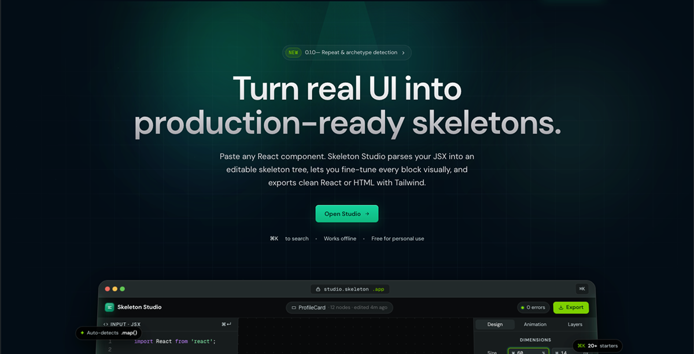

<div align="center">
  
  

  <p><strong>Paste a component → get a tweakable skeleton loader → copy production-ready code.</strong></p>

  <p>
    <a href="https://skeletons-studio.vercel.app"><strong>Try it live</strong></a> ·
    <a href="#getting-started">Getting Started</a> ·
    <a href="./CONTRIBUTING.md">Contributing</a>
  </p>

  <p>
    <a href="https://github.com/Ashikur540/skeleton-studio/actions/workflows/ci.yml"></a>
    <a href="https://github.com/Ashikur540/skeleton-studio/stargazers"></a>
    
    
    
    
    
  </p>

  <a href="https://skeletons-studio.vercel.app">
    
  </a>
</div>

---

## Why?

Every screen that loads data needs a skeleton loader: the grey boxes you see
while content arrives. Building one by hand is slow and boring. You copy your
component, delete the content, swap everything for grey boxes, then guess
sizes until it looks close. And when the real component changes, the skeleton
no longer matches, so the page jumps when the data loads.

**Skeleton Studio does that work for you.** You already wrote the component,
so it reads that and builds the skeleton from it.

## How it works

1. **Paste** your React/JSX component (or pick one of 12 starters).
2. **Tweak** the live preview: drag to resize blocks, change radius, spacing
   and animation in the side panel.
3. **Copy** clean **React + Tailwind** or **HTML + Tailwind** code.

**Example:** paste a profile card with an avatar, a name and a bio. You get
a round placeholder for the avatar, a short bar for the name and a few lines
for the bio, already sized from the Tailwind classes you wrote.

Parsing, preview and export all run in your browser. There is no backend
and no sign-up.

## Features

- **JSX → skeleton in one paste**: `@babel/parser` reads your component and
  infers structure.
- **Live, editable preview**: drag handles resize nodes; a properties panel
  edits any block.
- **Smart classification**: detects avatars, text, images, buttons, cards,
  inputs, and containers from tags + Tailwind classes.
- **Archetype detection**: recognizes media objects, forms, nav bars, heroes,
  card grids, stat tiles, and pricing cards to tune spacing automatically.
- **Repeat + variance**: `.map()` rows collapse into `repeat: N` with
  deterministic width variation so lists look natural.
- **Two export targets**: React+Tailwind JSX or plain HTML+Tailwind, formatted
  with Prettier.
- **Presets, animation, theming**: curated starters, shimmer/pulse animation
  controls, light/dark mode.
- **Undo/redo + keyboard shortcuts**: full history stack, arrow-nudge, delete.

## Getting Started

### Prerequisites

- Node.js 20+
- npm

### Install & run

```bash
git clone https://github.com/Ashikur540/skeleton-studio.git
cd skeleton-studio
npm install
cp .env.example .env   # adjust values if needed
npm run dev
```

Open <http://localhost:3000>.

### Run with Docker

```bash
docker build -t skeleton-studio .
docker run --rm -p 3000:3000 skeleton-studio
```

Open <http://localhost:3000>. The `NEXT_PUBLIC_*` values are baked in at
build time, so pass them as `--build-arg` if you need to change them. For a
server setup, see [docs/DOCKER-DEPLOY.md](./docs/DOCKER-DEPLOY.md).

### Environment variables

All vars are `NEXT_PUBLIC_*` (client-exposed). There are no server secrets.
See [`.env.example`](./.env.example).

| Variable                         | Required | Description                               |
| -------------------------------- | -------- | ----------------------------------------- |
| `NEXT_PUBLIC_PROJECT_VERSION`    | no       | Version shown in the UI footer.           |
| `NEXT_PUBLIC_SITE_URL`           | no       | Canonical site URL for absolute/OG links. |
| `NEXT_PUBLIC_CLARITY_PROJECT_ID` | no       | Microsoft Clarity ID. Blank disables it.  |

## Scripts

| Command              | Action                        |
| -------------------- | ----------------------------- |
| `npm run dev`        | Start the Next.js dev server. |
| `npm run build`      | Production build.             |
| `npm run start`      | Serve the production build.   |
| `npm run lint`       | ESLint (flat config).         |
| `npm test`           | Vitest (run once).            |
| `npm run test:watch` | Vitest (watch mode).          |

## Architecture

Everything flows through a single **Intermediate Representation (IR)**,
`SkeletonNode`. Renderers, exporters, and the properties panel all consume the
same tree, so there's one source of truth.

```
JSX String
  → @babel/parser            → AST
  → lib/parser/raw-node      → RawNode (structural snapshot)
  → semantic-classifier      → SkeletonNode (Tailwind hints + tag defaults)
  → table-grid + sibling-repeat → refined IR tree
  → [Preview] skeleton-renderer + runtime-styles → DOM
  → [Export]  react-tailwind / html-tailwind      → code string
```

| Layer       | Tech                                                      |
| ----------- | -------------------------------------------------------- |
| Framework   | Next.js 16 (App Router)                                  |
| UI          | React 19, TypeScript 5 (strict), shadcn/ui (Radix)       |
| Styling     | Tailwind CSS v4 (CSS-first config)                       |
| State       | Zustand v5 + `persist` (only source + settings persisted) |
| JSX parsing | `@babel/parser` + `@babel/types`                        |
| Editor      | CodeMirror 6                                             |
| Formatting  | Prettier standalone (browser build)                      |
| Testing     | Vitest v4 (`environment: "node"`)                        |

Pure logic lives in `lib/**` (framework-agnostic, fully unit-tested). UI
components are all `"use client"`; the only server components are
`app/layout.tsx` and `app/page.tsx`. See [`AGENTS.md`](./AGENTS.md) for the
full architecture reference.

## Testing

```bash
npm test
```

Deep unit tests cover the parser pipeline, exporters, presets, and store
behavior. Tests are co-located (`*.test.ts` next to source). CI runs lint,
tests and a production build on every pull request.

## Deployment

The live demo runs on [Vercel](https://vercel.com): import the repo, set the
`NEXT_PUBLIC_*` env vars, and deploy. Any Node host that runs
`npm run build && npm run start` works too, or use the Docker image above.

## Contributing

Contributions welcome. Read [CONTRIBUTING.md](./CONTRIBUTING.md) and our
[Code of Conduct](./CODE_OF_CONDUCT.md) first. Found a component that turns
into a bad skeleton? [Open an issue](https://github.com/Ashikur540/skeleton-studio/issues/new/choose)
with the JSX you pasted.

If Skeleton Studio saves you time, a ⭐ helps other developers find it.

## Security

To report a vulnerability, see [SECURITY.md](./SECURITY.md).

## Author

Built by **Ashikur Rahman**, a frontend-focused full-stack developer.
[GitHub](https://github.com/Ashikur540) ·
[LinkedIn](https://linkedin.com/in/md-ashikurrahman)

## License

[MIT](./LICENSE) © Ashikur Rahman
